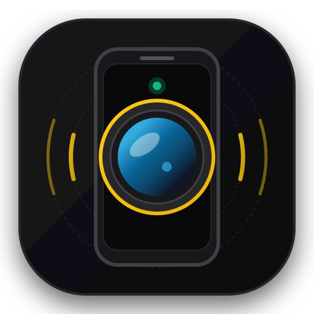
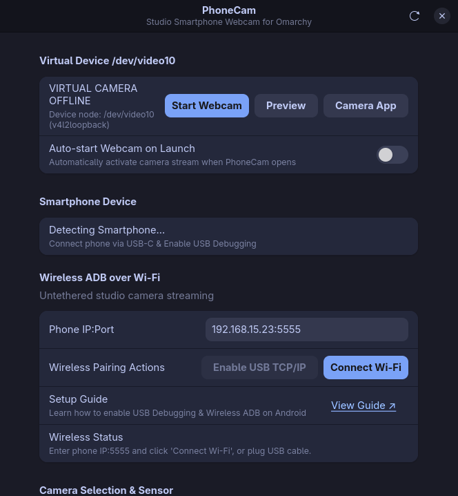
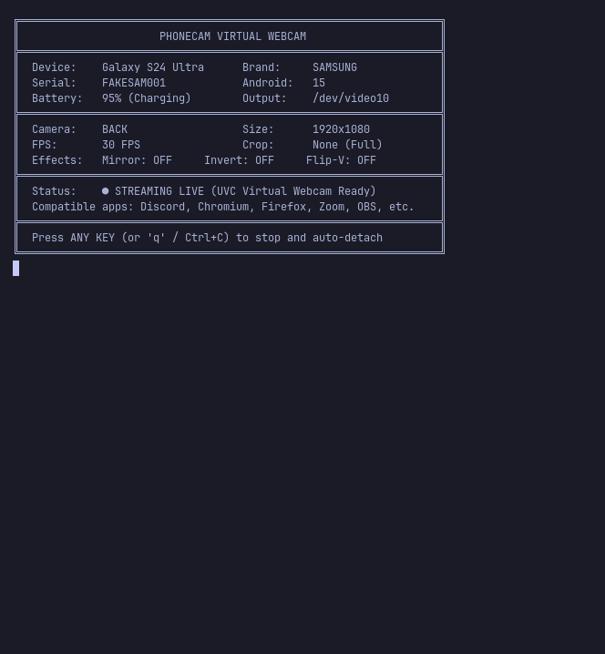
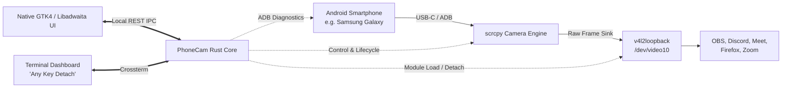

<p align="center">
  
</p>

<h1 align="center">PhoneCam</h1>

<p align="center">
  <strong>High-performance smartphone webcam virtual device manager for Omarchy Linux and Arch Linux.</strong><br>
  Built natively in <strong>Rust</strong> with an <strong>Omarchy-styled GTK4 / Libadwaita UI</strong>, leveraging <code>scrcpy</code> and <code>v4l2loopback</code> for zero-latency, studio-quality camera streaming directly into <code>/dev/video10</code>.
</p>

---

## Screenshots

### Modern GTK4 / Libadwaita Desktop Interface


### Interactive Terminal Dashboard (TUI)


---

## Overview & Architecture

**PhoneCam** transforms your Android smartphone (Samsung Galaxy, Google Pixel, OnePlus, etc.) into a studio-grade virtual webcam for Linux. Any desktop application—including **OBS Studio, Discord, Google Meet, Chromium, Firefox, Zoom, and Teams**—recognizes your phone as a standard UVC webcam (`/dev/video10`).



---

## Key Features

- **Wireless ADB over Wi-Fi & Fault-Tolerant Reconnection**:
  - Connect wirelessly to smartphones on your local network (`IP:PORT` or `IP:5555`).
  - One-click **Enable USB TCP/IP** button switches a USB-connected phone to port 5555 before unplugging the cable.
  - Fault tolerance standby: if the phone disconnects or Wi-Fi drops, background standby frames feed `/dev/video10` to prevent client apps (OBS, Discord, Zoom) from crashing, and automatically re-attaches upon reconnection.
- **Smart Phone & ADB Detection**:
  - Automatically identifies phone brand, model, Android version, and live battery level.
  - Clear user guidance if the phone is disconnected, offline, or awaiting USB debugging authorization.
- **Bidirectional Camera Selection**:
  - Click **Rear (Back)** or **Selfie (Front)** and the lens dropdown updates automatically to the primary sensor.
  - Select any specific camera lens (Wide, Ultrawide, Telephoto) and the front/back toggles automatically synchronize.
  - Automatically avoids the `Cannot specify both --camera-id and --camera-facing` conflict.
- **Cut & Aspect Ratio Crop**:
  - **Full Sensor**: Native uncropped camera sensor frame.
  - **16:9 Widescreen Crop**: High-speed native aspect ratio cropping (`--camera-ar=16:9`).
  - **4:3 Standard Crop**: Traditional video call framing (`--camera-ar=4:3`).
  - **1:1 Square (Avatar)**: Square crop for social media and avatar streams (`--camera-ar=1:1`).
  - **Custom Center Cut**: Pixel-perfect centering (`--crop=1920:1080:0:0`).
- **Dynamic Theme Switching**:
  - Six instant palette presets: **Cyber Cyan** (`#00F2FE`), **Cyber Emerald** (`#10B981`), **Sky Blue** (`#38BDF8`), **Neon Violet** (`#A855F7`), **Sunset Orange** (`#F97316`), and **Rose Pink** (`#F43F5E`).
  - Reads live desktop theme from `~/.local/state/omarchy/current/theme/colors.toml`.
- **Live Desktop Preview**:
  - Click the **Preview** button or toggle to view a real-time on-screen monitor window while streaming to `/dev/video10`.
- **One-Time Root Setup (Zero Root Runtime)**:
  - Configures kernel autoloading at boot (`/etc/modules-load.d/v4l2loopback.conf`), module options (`/etc/modprobe.d/v4l2loopback.conf`), and non-root device permissions (`/etc/udev/rules.d/99-v4l2loopback.rules`).
  - **Root is required only once during installation.** Runtime execution runs 100% as an unprivileged user without password prompts.
- **Flip, Mirror & Invert Transformations**:
  - **Horizontal Mirror**: Natural webcam selfie orientation.
  - **Vertical Flip (180°)**: Correct upside-down tripod mountings.
  - **Color Invert (Negative)**: Real-time hardware ffmpeg negative filter.
- **Auto-Detaching & Clean Teardown**:
  - Pressing **ANY KEY** in the terminal dashboard or closing the GUI instantly terminates `scrcpy` and cleanly unloads `/dev/video10`.

---

## Requirements & Dependencies

| Dependency | Purpose | Arch Linux Package |
|---|---|---|
| `rust` & `cargo` | Compilation | `pacman -S rust` |
| `scrcpy` | Android camera video capture engine | `pacman -S scrcpy` |
| `android-tools` | ADB communication | `pacman -S android-tools` |
| `v4l2loopback-dkms` | Kernel virtual video device | `pacman -S v4l2loopback-dkms` |
| `gtk4` | Native GTK4 desktop toolkit | `pacman -S gtk4` |
| `libadwaita` | Modern Omarchy Adwaita widgets | `pacman -S libadwaita` |
| `ffmpeg` | Inversion stream filter | `pacman -S ffmpeg` |

---

## Installation & System Packaging

```bash
cd ~/dev/phonecam
./scripts/install.sh
```

The script:
1. Compiles the optimized release binary (`cargo build --release`).
2. Installs `/usr/local/bin/phonecam` and `~/.local/bin/phonecam`.
3. Registers `.desktop` launcher and scalable vector icons.
4. Configures one-time root permissions (`modules-load.d`, `modprobe.d`, `udev`, and `sudoers`).
5. Configures the **Omarchy Menu** (`Super + Space` -> search `PhoneCam` or `webcam`).

---

## Usage & Controls

### Launch GUI
```bash
phonecam
```
Or summon from the Omarchy Menu: `Super + Space` -> search **PhoneCam**.

### Interactive Terminal Dashboard (TUI)
```bash
phonecam --tui
```
*Press ANY key (or 'q' / Ctrl+C) to stop and auto-detach the virtual device.*

### CLI Commands
```bash
# Start streaming in headless mode
phonecam --start

# Start front camera mirrored in 720p with 16:9 crop
phonecam --start --facing front --mirror --res 1280x720 --camera-ar 16:9

# Inspect connected cameras
phonecam --list-cameras

# Inspect status
phonecam --status

# Enable TCP/IP on USB-connected phone
phonecam --tcpip 5555

# Connect over Wi-Fi
phonecam --wifi 192.168.1.50:5555

# Detach virtual camera manually
phonecam --detach
```

---

## Configuration (`config.toml`)

PhoneCam persists all preferences (selected camera, resolution, rotation, flip, auto-start, and Wi-Fi addresses) automatically in `~/.config/phonecam/config.toml`.

An annotated template is provided in [`config.example.toml`](config.example.toml):

```toml
# Default IP address and port for ADB over Wi-Fi
last_ip = "192.168.1.50:5555"

# List of remembered IP addresses
saved_ips = [
    "192.168.1.50:5555"
]

# Camera facing: "back" or "front"
facing = "back"

# Target capture resolution: "1920x1080", "1280x720", "3840x2160"
resolution = "1920x1080"

# Mirror stream horizontally (natural webcam preview)
flip_h = false

# Stream rotation: 0 (Normal), 90 (Clockwise), 180 (Inverted), 270 (Counter-Clockwise)
rotation = 0

# Invert stream colors (color negative effect)
invert = false

# Enable torch / flashlight (back camera only)
torch = false

# Automatically start streaming webcam when PhoneCam launches
auto_start = false
```

---

## Testing & Verification

PhoneCam features an extensive automated test suite covering unit tests, integration tests, GTK4 widget interactions, TUI PTY sessions, and live video stream OCR verification:

```bash
# Run all unit and integration tests
cargo test --all-targets

# Run Fake Phone E2E test suite (mocked ADB & hardware)
cargo test --test fake_phone_e2e

# Run Native GTK4 / Libadwaita UI test suite (click simulation & widget tree)
cargo test --test ui_test

# Run Terminal TUI dashboard PTY & keypress E2E test
./tests/test-tui-e2e.sh

# Run Video Stream Hardware OCR transformation verification
./tests/test-ocr-e2e.sh

# Run complete UI test suite
./tests/test-ui.sh

# Run complete package lifecycle verification
./tests/test-package-e2e.sh
```

### UI TestIDs (`widget_name` / `objectName`) Reference
For end-to-end automation and testing, all interactive elements in `src/ui/gtk_app.rs` and `src/ui/Main.qml` expose standard test IDs:

| TestID (`objectName`) | Control Type | Description |
| :--- | :--- | :--- |
| `btn-camera-rear` | Button | Toggles rear camera (`facing: "back"`) |
| `btn-camera-front` | Button | Toggles selfie camera (`facing: "front"`) |
| `combo-camera-lens` | ComboBox | Selects specific phone lens sensor |
| `combo-resolution` | ComboBox | Selects resolution (1080p, 720p, 4K, 2K) |
| `combo-crop` | ComboBox | Selects crop preset (16:9, 4:3, 1:1, custom) |
| `combo-rotation` | ComboBox | Selects rotation (0°, 90°, 180°, 270°) |
| `switch-flip-h` | Switch | Horizontal flip / mirror |
| `switch-invert` | Switch | Hardware color inversion filter |
| `switch-torch` | Switch | Flashlight / studio torch |
| `switch-auto-start` | Switch | Auto-starts stream on launch |
| `btn-preview` | Button | Opens live preview window for `/dev/video10` |
| `btn-launch-camera` | Button | Launches native Camera app (`snapshot`) |
| `btn-stream-action` | Button | Starts / stops `/dev/video10` stream |
| `btn-refresh` | Button | Manually polls ADB device status & logs |
| `input-wifi-address` | TextField | Enters phone IP:Port for wireless ADB |
| `btn-wifi-connect` | Button | Connects to phone wirelessly via ADB |
| `btn-wifi-tcpip` | Button | Enables TCP/IP port 5555 on USB phone |
| `link-adb-docs` | LinkButton | Opens Android debugging setup guide |
| `text-wifi-status` | Text | Displays live status and wireless guidance |

---

## License

MIT License © 2026 Rodrigo Vieira.
