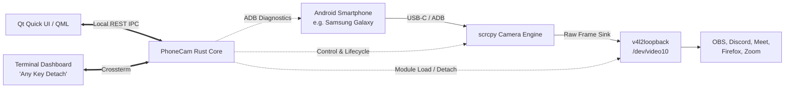

# PhoneCam 📱📹

> **High-performance smartphone webcam virtual device manager for Omarchy Linux and Arch Linux.**  
> Built natively in **Rust** with an **Omarchy-styled Qt Quick (QML) UI**, leveraging `scrcpy` and `v4l2loopback` for zero-latency, studio-quality camera streaming directly into `/dev/video10`.

---

## 📸 Screenshots

### Modern Qt Quick Desktop Interface


### Interactive Terminal Dashboard (TUI)
```text
╔══════════════════════════════════════════════════════════════════╗
║                    📱 PHONECAM VIRTUAL WEBCAM                    ║
╠══════════════════════════════════════════════════════════════════╣
║  Device:    Galaxy S24        Brand:   SAMSUNG                ║
║  Serial:    RFCNC000000          Android: 16                     ║
║  Battery:   84% ⚡                Output:  /dev/video10           ║
╠══════════════════════════════════════════════════════════════════╣
║  Camera:    BACK                 Size:    1920x1080              ║
║  Framerate: 30 FPS               Crop:    16:9 Widescreen        ║
║  Effects:   Mirror: OFF | Invert: OFF | Flip-V: OFF              ║
╠══════════════════════════════════════════════════════════════════╣
║  Status:    ● STREAMING LIVE (UVC Virtual Webcam Ready)         ║
║  Compatible apps: Discord, Chromium, Firefox, Zoom, OBS, etc.   ║
╠══════════════════════════════════════════════════════════════════╣
║  👉 Press ANY KEY (or 'q' / Ctrl+C) to stop and auto-detach     ║
╚══════════════════════════════════════════════════════════════════╝
```

---

## 🚀 Overview & Architecture

**PhoneCam** transforms your Android smartphone (Samsung Galaxy, Google Pixel, OnePlus, etc.) into a studio-grade virtual webcam for Linux. Any desktop application—including **OBS Studio, Discord, Google Meet, Chromium, Firefox, Zoom, and Teams**—recognizes your phone as a standard UVC webcam (`/dev/video10`).



---

## ✨ Features

- **📱 Smart Phone & ADB Detection**:
  - Automatically identifies phone brand, model, Android version, and live battery level.
  - Clear user guidance if the phone is disconnected, offline, or awaiting USB debugging authorization.
- **🔄 Bidirectional Camera Selection**:
  - Click **Rear (Back)** or **Selfie (Front)** and the lens dropdown updates automatically to the primary sensor.
  - Select any specific camera lens (Wide, Ultrawide, Telephoto) and the front/back toggles automatically synchronize.
  - Automatically avoids the `Cannot specify both --camera-id and --camera-facing` conflict.
- **✂️ Cut & Aspect Ratio Crop**:
  - **Full Sensor**: Native uncropped camera sensor frame.
  - **16:9 Widescreen Crop**: High-speed native aspect ratio cropping (`--camera-ar=16:9`).
  - **4:3 Standard Crop**: Traditional video call framing (`--camera-ar=4:3`).
  - **1:1 Square (Avatar)**: Square crop for social media and avatar streams (`--camera-ar=1:1`).
  - **Custom Center Cut**: Pixel-perfect centering (`--crop=1920:1080:0:0`).
- **🎨 Dynamic Theme Switching**:
  - Six instant palette presets: **Omarchy Gold** (`#FFD60A`), **Cyber Emerald** (`#10B981`), **Sky Blue** (`#38BDF8`), **Neon Violet** (`#A855F7`), **Sunset Orange** (`#F97316`), and **Rose Pink** (`#F43F5E`).
  - Reads live desktop theme from `~/.local/state/omarchy/current/theme/colors.toml`.
- **👁️ Live On-Screen Preview**:
  - Click the **👁️ Preview** button or toggle to view a real-time on-screen monitor window while streaming to `/dev/video10`.
- **🔐 One-Time Root Setup (Zero Root Runtime)**:
  - Configures kernel autoloading at boot (`/etc/modules-load.d/v4l2loopback.conf`), module options (`/etc/modprobe.d/v4l2loopback.conf`), and non-root device permissions (`/etc/udev/rules.d/99-v4l2loopback.rules`).
  - **Root is required only once during installation.** Runtime execution runs 100% as an unprivileged user without password prompts.
- **🪞 Flip, Mirror & Invert**:
  - **Horizontal Mirror**: Natural webcam selfie orientation.
  - **Vertical Flip (180°)**: Correct upside-down tripod mountings.
  - **Color Invert (Negative)**: Real-time hardware ffmpeg negative filter.
- **⚡ Auto-Detaching & Clean Teardown**:
  - Pressing **ANY KEY** in the terminal dashboard or closing the GUI instantly terminates `scrcpy` and cleanly unloads `/dev/video10`.

---

## 🛠️ Requirements & Dependencies

| Dependency | Purpose | Arch Linux Package |
|---|---|---|
| `rust` & `cargo` | Compilation | `pacman -S rust` |
| `scrcpy` | Android camera video capture engine | `pacman -S scrcpy` |
| `android-tools` | ADB communication | `pacman -S android-tools` |
| `v4l2loopback-dkms` | Kernel virtual video device | `pacman -S v4l2loopback-dkms` |
| `qt6-declarative` | QML runtime (`qml6`) | `pacman -S qt6-declarative` |
| `qt6-quickcontrols2` | Modern UI Controls | `pacman -S qt6-quickcontrols2` |
| `ffmpeg` | Inversion stream filter | `pacman -S ffmpeg` |

---

## 📦 Installation

```bash
cd ~/dev/phonecam
./scripts/install.sh
```

The script:
1. Compiles the optimized release binary (`cargo build --release`).
2. Installs `/usr/local/bin/phonecam` and `~/.local/bin/phonecam`.
3. Installs QML UI files to `/usr/local/share/phonecam/ui/`.
4. Registers `.desktop` launcher and scalable icons.
5. Configures one-time root permissions (`modules-load.d`, `modprobe.d`, `udev`, and `sudoers`).
6. Configures the **Omarchy Menu** (`Super + Space` -> search `PhoneCam` or `webcam`).

---

## 🎮 Usage

### Launch GUI
```bash
phonecam
```
Or summon from the Omarchy Menu: `Super + Space` -> search **PhoneCam**.

### Interactive Terminal Dashboard (TUI)
```bash
phonecam --tui
```
*Press ANY key (or 'q' / Ctrl+C) to stop and auto-detach the virtual device.*

### CLI Commands
```bash
# Start streaming in headless mode
phonecam --start

# Start front camera mirrored in 720p with 16:9 crop
phonecam --start --facing front --mirror --res 1280x720 --camera-ar 16:9

# Inspect connected cameras
phonecam --list-cameras

# Inspect status
phonecam --status

# Detach virtual camera manually
phonecam --detach
```

---

## 🧪 Testing & E2E Verification

PhoneCam features a comprehensive test suite including **fake phone E2E tests** that mock ADB and scrcpy without needing physical hardware:

```bash
# Run all unit and integration tests
cargo test --all-targets

# Run Fake Phone E2E test suite
cargo test --test fake_phone_e2e

# Run complete package lifecycle verification
./tests/test-package-e2e.sh

# Run code coverage report
cargo llvm-cov --summary-only
```

---

## 📄 License

MIT License © 2026 Rodrigo Vieira.
