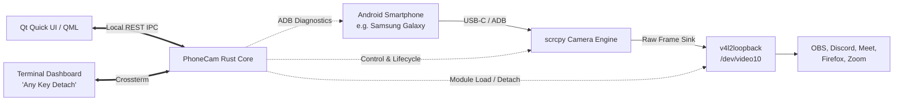

# PhoneCam 📱📹

> **High-performance smartphone webcam virtual device manager for Omarchy Linux and Arch Linux.**  
> Built natively in **Rust** with an **Omarchy-styled Qt Quick (QML) UI**, leveraging `scrcpy` and `v4l2loopback` for zero-latency, high-definition camera streaming directly into `/dev/video10`.

---

## 🚀 Overview

**PhoneCam** transforms your Android smartphone (e.g., Samsung Galaxy S24, Google Pixel, OnePlus) into a studio-grade virtual webcam for Linux. Any desktop application—including **OBS Studio, Discord, Google Meet, Chromium, Firefox, Zoom, and Teams**—recognizes your phone as a standard UVC webcam (`/dev/video10`).

PhoneCam is built from scratch in **Rust** with a companion **Qt Quick / QML** modern dark interface following the Omarchy desktop design system.



---

## ✨ Features

- **📱 Intelligent Phone & ADB Detection**:
  - Automatically identifies phone brand, model, Android version, and live battery level.
  - Clear user feedback if the phone is disconnected, offline, or awaiting USB debugging authorization.
- **🔄 Instant Camera Selection**:
  - Switch smoothly between **Front (Selfie)** and **Back (Rear)** cameras.
  - Enumerate and select specific multi-camera lenses (Wide, Ultrawide, Telephoto).
- **✂️ Cut & Crop Presets**:
  - **Full Sensor**: Complete optical frame without cropping.
  - **16:9 Widescreen**: Standard modern webcam aspect ratio.
  - **4:3 Classic**: Traditional portrait/video call framing.
  - **1:1 Square**: Perfect for profile avatars and social streams.
- **📐 Resize & Resolution**:
  - 1080p Full HD (`1920x1080`) @ 30/60 FPS (Default).
  - 720p HD (`1280x720`).
  - 4K Ultra HD (`3840x2160`).
  - 2K Quad HD (`2560x1440`).
- **🪞 Flip & Mirror**:
  - **Horizontal Flip (Mirror)**: Essential for a natural webcam selfie experience.
  - **Vertical Flip (180°)**: Correct upside-down tripod and overhead mountings.
- **🎨 Color Inversion (Negative Filter)**:
  - Hardware-accelerated color inversion filter via real-time ffmpeg negate stream piping.
- **💡 Flashlight / Torch**:
  - Toggle smartphone LED flashlight for rear camera studio lighting.
- **⚡ Auto-Detaching & Clean Teardown**:
  - When closing the GUI, pressing `Escape`, or pressing **ANY KEY** in the Terminal TUI dashboard, the virtual video device is safely detached and processes are cleaned up instantly.
- **🎨 Omarchy Desktop Native**:
  - Reads live Omarchy accent colors (`~/.local/state/omarchy/current/theme/colors.toml`).
  - Integrated into the **Quickshell Omarchy Menu** (`Super + Space` -> search "webcam" or "phonecam").
  - Desktop `.desktop` entry with vector SVG and 512x512 PNG app icons.

---

## 🛠️ Requirements & Dependencies

PhoneCam is optimized for Arch Linux and Omarchy:

| Dependency | Purpose | Arch Package |
|------------|---------|--------------|
| `rust` & `cargo` | Compilation | `pacman -S rust` |
| `scrcpy` | High-performance Android video streaming | `pacman -S scrcpy` |
| `android-tools` | ADB device communication | `pacman -S android-tools` |
| `v4l2loopback-dkms` | Kernel virtual video device | `pacman -S v4l2loopback-dkms` |
| `qt6-declarative` | QML engine & runtime (`qml6`) | `pacman -S qt6-declarative` |
| `qt6-quickcontrols2` | Modern UI Controls | `pacman -S qt6-quickcontrols2` |
| `ffmpeg` | Inversion filter & video pipeline | `pacman -S ffmpeg` |

---

## 📦 Installation

### Quick Install (Recommended)

From the project root:

```bash
cd ~/dev/phonecam
./scripts/install.sh
```

The script will:
1. Compile the optimized release binary (`cargo build --release`).
2. Install the binary to `/usr/local/bin/phonecam` and `~/.local/bin/phonecam`.
3. Install the Qt Quick QML interface to `/usr/local/share/phonecam/ui/`.
4. Register the `.desktop` launcher and application icons.
5. Configure passwordless `v4l2loopback` management in `/etc/sudoers.d/phonecam-v4l2loopback`.
6. Add shortcut actions into `~/.config/omarchy/extensions/omarchy-menu.jsonc`.

### Arch Linux Package (PKGBUILD)

```bash
cd ~/dev/phonecam/pkgbuild
makepkg -fsi
```

---

## 🎮 Usage

### 1. Launch the Qt Quick GUI

Simply run:
```bash
phonecam
```
Or launch **PhoneCam** from the Omarchy application launcher or the Omarchy menu (`Super + Space` -> type `webcam`).

### 2. Interactive Terminal Dashboard (TUI)

```bash
phonecam --tui
```
Runs a real-time ANSI terminal dashboard displaying phone status, battery, active camera settings, and video node.  
**Press ANY key (or `q` / `Ctrl+C`) to instantly stop and auto-detach the virtual device.**

### 3. Headless CLI Streaming

```bash
# Start streaming rear camera in 1080p
phonecam --start

# Start front camera mirrored in 720p
phonecam --start --facing front --mirror --res 1280x720

# Query connected phone cameras
phonecam --list-cameras

# Detach virtual camera node manually
phonecam --detach
```

---

## ⌨️ Keyboard Shortcuts

| Shortcut | Action |
|----------|--------|
| `Space` | Toggle Webcam Start / Stop |
| `Escape` | Stop streaming & close application |
| `q` | Stop streaming & detach |
| `Ctrl+C` | Graceful shutdown & virtual device unload |

---

## 🏗️ Repository Layout

```text
phonecam/
├── Cargo.toml                # Rust crate manifest & dependencies
├── assets/
│   ├── phonecam.svg          # Master scalable vector logo
│   └── phonecam.png          # 512x512 rendered raster icon
├── pkgbuild/
│   ├── PKGBUILD              # Arch Linux package specification
│   └── phonecam.desktop      # Desktop application entry
├── scripts/
│   ├── install.sh            # Complete system installer
│   └── uninstall.sh          # Clean uninstaller
├── src/
│   ├── main.rs               # Entry point, CLI argument parsing, runtime mode
│   ├── config.rs             # Configuration models & orientation calculations
│   ├── adb.rs                # ADB detection, battery polling, camera enumeration
│   ├── v4l2.rs               # v4l2loopback setup, permissions, teardown
│   ├── pipeline.rs           # scrcpy/ffmpeg stream management & filters
│   ├── server.rs             # Internal HTTP REST IPC server for Qt UI
│   ├── tui.rs                # Terminal dashboard with crossterm raw listener
│   └── util.rs               # Privilege elevation & Omarchy theme detection
├── ui/
│   └── Main.qml              # Omarchy-styled Qt Quick application window
├── README.md                 # Project documentation
├── AGENTS.md                 # Contributor and AI Agent guidelines
└── LICENSE                   # MIT License
```

---

## 📄 License

MIT License © 2026 Rodrigo Vieira.
